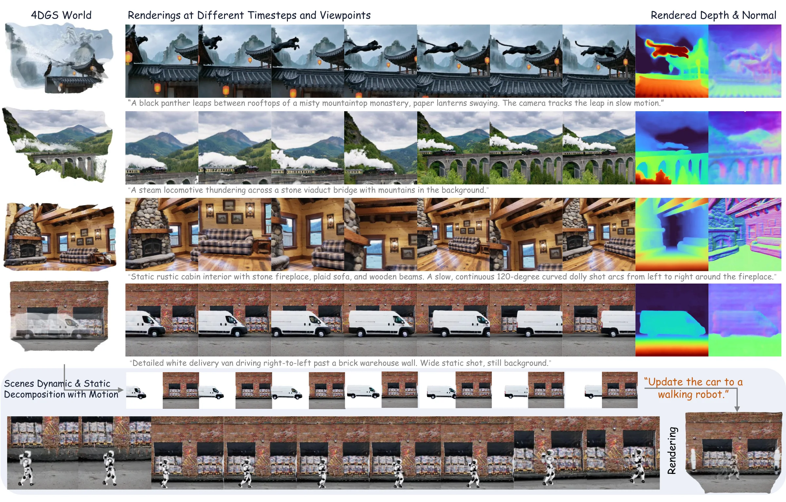
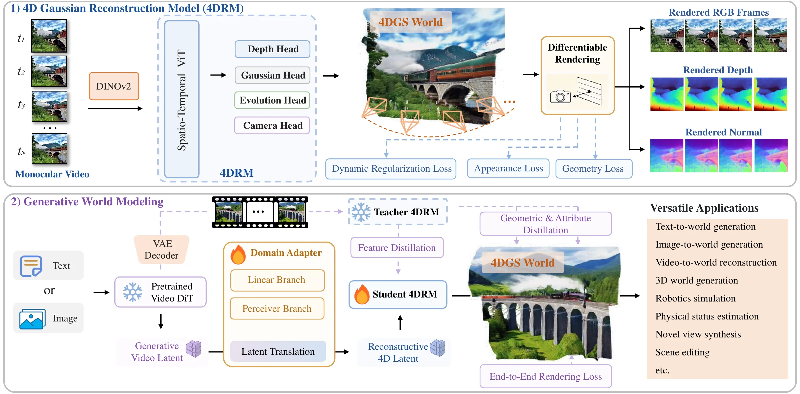
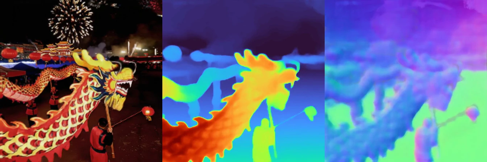
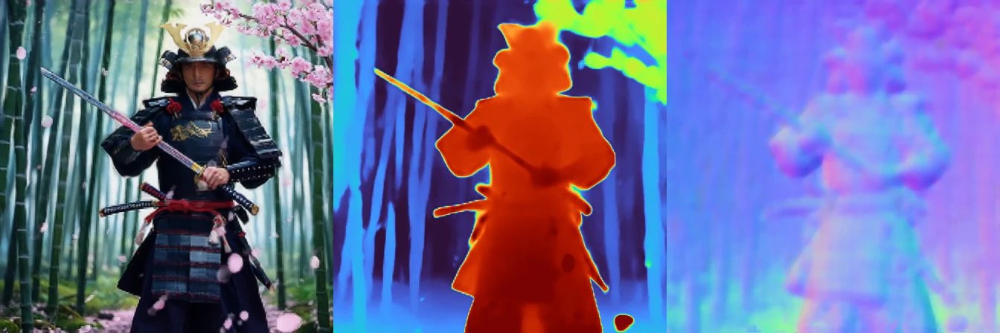
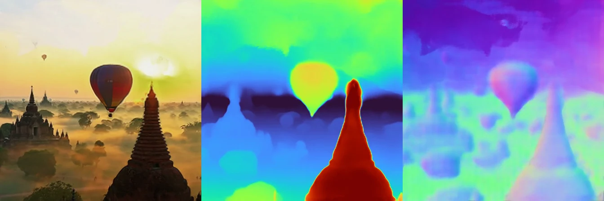
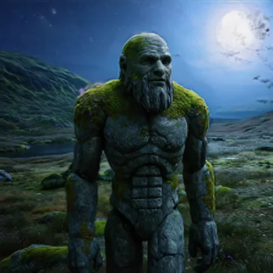
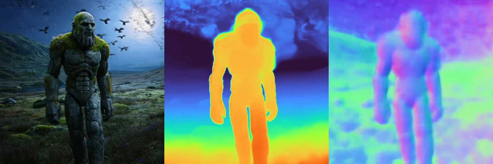

<div align="center">

# AEON: Unifying Video and 3D World Models

### NeurIPS 2026

[Weiqi Zhang](https://weiqi-zhang.github.io/), [Wenyuan Zhang](https://wen-yuan-zhang.github.io/), [Yu-Shen Liu](https://yushen-liu.github.io/)<sup>†</sup>, [Junsheng Zhou](https://junshengzhou.github.io/)<sup>†</sup>

School of Software, Tsinghua University

<sup>†</sup> Corresponding authors

[](https://weiqi-zhang.github.io/AEON/)
[](https://arxiv.org/abs/2610.28631)
[](https://huggingface.co/wiki1231/AEON)

</div>



AEON is a generative world model that unifies video-based and 3D-based world models. It works in the latent space
of a pretrained video diffusion model and produces an explicit **4D Gaussian Splatting (4DGS)** world together with
its camera trajectory. The 4DGS world can be rendered in real time at any timestep and from new viewpoints, and it
can be edited or used for simulation. See the [project page](https://weiqi-zhang.github.io/AEON/) for more details.

This repository contains the inference code and the AEON decoder for text-to-4DGS (Wan2.1 T2V-1.3B) and
image-to-4DGS (Wan2.1 I2V-14B-480P) generation.

## Method



At inference time:

1. Wan2.1 generates a video latent from the prompt (and the image, for I2V). The Wan VAE decodes it into frames.
2. The domain adapter and the student 4DRM map the latent to per-pixel 4D Gaussians and per-frame cameras.
3. The Gaussians are rasterized with gsplat along the predicted cameras and, optionally, along a spiral novel-view
   path.

## Generated worlds

Each row shows the RGB, depth and normal maps rendered from a generated 4DGS world. More worlds, with videos, are on
the [project page](https://weiqi-zhang.github.io/AEON/#worlds).

### Text-to-4DGS



*"A traditional dragon dance winds through a Lunar New Year night market, fireworks exploding overhead, red lanterns
swaying. The camera tracks the dragon's head from above in a steadicam shot."*



*"A samurai drawing his katana in a bamboo forest, cherry blossom petals floating in the wind."*

### Image-to-4DGS

The condition image is on the left.

 

*"A hot-air balloon parade drifts over the temples of Bagan at sunrise, golden mist clinging to the stupas. The camera
glides alongside one balloon, then sweeps up to a wide aerial."*

 

*"An ancient stone golem walks across a moor at moonrise, moss and lichen covering its shoulders, owls circling. The
camera dollies backward as it approaches."*

## Installation

Requirements:

- Python 3.10 or newer, and a CUDA GPU.
- PyTorch built for your CUDA version. Tested with torch 2.13 + CUDA 13.0 on Python 3.12.
- The CUDA toolkit (`nvcc`) and `ninja` on `PATH`.

gsplat compiles its CUDA kernels the first time it runs. This takes about a minute, and the result is cached under
`TORCH_EXTENSIONS_DIR`.

Use a dedicated virtual environment: diffusers and transformers are pinned to the versions AEON was validated with.

```bash
pip install -r requirements.txt
pip install -e .            # installs the `aeon-4d` package (import name `aeon4d`) and the `aeon-generate` command
```

## Weights

| Model | Size | Used for |
|---|---|---|
| [wiki1231/AEON](https://huggingface.co/wiki1231/AEON) | 3.3 GB | video latent → 4DGS (AEON decoder) |
| [Wan-AI/Wan2.1-T2V-1.3B-Diffusers](https://huggingface.co/Wan-AI/Wan2.1-T2V-1.3B-Diffusers) | 29 GB | text → video |
| [Wan-AI/Wan2.1-I2V-14B-480P-Diffusers](https://huggingface.co/Wan-AI/Wan2.1-I2V-14B-480P-Diffusers) | 90 GB | image + text → video |

Download the decoder weights to `weights/aeon.safetensors` in the repository, or keep them elsewhere and pass their
path with `--weights`:

```bash
huggingface-cli download wiki1231/AEON aeon.safetensors --local-dir weights
```

By default the Wan models are loaded by their Hugging Face ids. To use a local copy, pass its directory with
`--wan_model`. You can download a local copy from Hugging Face or ModelScope:

```bash
huggingface-cli download Wan-AI/Wan2.1-T2V-1.3B-Diffusers --local-dir pretrained/Wan2.1-T2V-1.3B-Diffusers
modelscope download --model Wan-AI/Wan2.1-T2V-1.3B-Diffusers --local_dir pretrained/Wan2.1-T2V-1.3B-Diffusers
```

The I2V repository's `text_encoder`, `tokenizer`, `vae` and `scheduler` folders are identical to the ones in the
T2V-1.3B repository. If you already have the T2V model, you only need to download `transformer/`, `image_encoder/`,
`image_processor/` and `model_index.json`, then symlink the other folders.

## Usage

```bash
# Text -> 4DGS, plus a spiral novel-view video and an export of the Gaussians
aeon-generate --prompt "A red fox running through deep snow, slow motion" --spiral --save_4dgs

# Batch generation, one prompt per line
aeon-generate --prompts prompts.txt --output_dir outputs/batch --spiral

# Image + text -> 4DGS with the 14B model (--cpu_offload keeps GPU memory around 50 GB)
aeon-generate --pipeline i2v --pairs pairs.tsv --cpu_offload --spiral --save_4dgs
aeon-generate --pipeline i2v --image ref.png --prompt "The cat walks to the window" --cpu_offload
```

Each line of `pairs.tsv` is `<image path>\t<prompt>`. JSONL lines with `image` and `prompt` keys also work.

`python -m aeon4d ...` is equivalent to `aeon-generate`. The table below lists the most useful options; run
`aeon-generate -h` for all of them.

| Option | Default | Meaning |
|---|---|---|
| `--num_frames / --steps / --cfg / --flow_shift / --seed` | 81 / 50 / 5.0 / 3.0 / 42 | Wan sampling settings |
| `--height --width` | T2V 512×512, I2V 480×832 | video resolution |
| `--spiral`, `--spiral_motion_mode` | off, `moving_look_forward` | render a spiral novel-view video whose path follows the generated camera |
| `--save_4dgs` | off | write `4dgs/gs_params.pt` (all Gaussian attributes) and `4dgs/scene_info.json` (cameras) |
| `--save_3dgs` | off | write a static, Inria-format `3dgs/point_cloud.ply` (temporal fields dropped) for standard 3DGS viewers |
| `--decode_k_mode / --decode_k_sigma` | `gaussian` / 5 | smooth the recovered intrinsics over time before placing the Gaussians |
| `--fix_k_mode` | `none` | aggregate the intrinsics again at render time |
| `--keep_dxyzt` | off | keep the predicted position residual (it is zeroed by default) |
| `--render_h --render_w` | 448 | rasterization resolution; the number of Gaussians does not change |
| `--cpu_offload` | off | use diffusers model CPU offload for the Wan pipeline |

### Outputs

```
<output_dir>/<NNN>_<prompt>/
  b0_generated_video.mp4        Wan video (decoded latent)
  b0_render_rgb.mp4             4DGS rendered from the generated cameras
  b0_render_depth.mp4, b0_render_normal_gs.mp4, b0_render_normal_surf.mp4
  b0_side_by_side.mp4           generated | rendered
  frames/                       per-frame PNGs (generated and rendered)
  spiral/b0_spiral_{rgb,depth,normal_gs}.mp4     with --spiral
  4dgs/  3dgs/                  with --save_4dgs / --save_3dgs
  wan_latents.pt                latent cache; re-running a sample skips diffusion
```

## Python API

```python
import torch
from aeon4d.pipeline import (DEFAULT_CONFIG, denoise_video_latents, load_aeon, load_config,
                             load_wan_pipeline, reconstruct_4dgs, zero_dxyzt_)
from aeon4d.rendering import render_4dgs

config = load_config(DEFAULT_CONFIG)
device = torch.device("cuda:0")
torch.manual_seed(42)
pipe = load_wan_pipeline("Wan-AI/Wan2.1-T2V-1.3B-Diffusers", "t2v", flow_shift=3.0, device=device)
model = load_aeon(config, config["weights"], device)

latents = denoise_video_latents(pipe, "A red fox running through deep snow", height=512, width=512,
                                num_frames=81, num_inference_steps=50, guidance_scale=5.0,
                                negative_prompt="Blurred, artifacts, low quality, distorted, deformed")
video, views, res, gs_params = reconstruct_4dgs(model, pipe.vae, latents, vae_resolution=512,
                                                ff_resolution=448, device=device)
zero_dxyzt_(gs_params)
render = render_4dgs(gs_params, res, device, render_h=448, render_w=448, fix_k_mode="none")
```

See `aeon4d/cli.py` for the complete flow, including saving the outputs.

## Resource usage

- **T2V-1.3B:** about 60 GB of GPU memory at peak.
- **I2V-14B with** `--cpu_offload`**:** about 50 GB. Without offload, it needs roughly 90 GB.
- **Speed:** a sample with the 14B model takes about 5–8× longer than one with the 1.3B model.

## Citation

If you find AEON useful in your research, please cite:

```bibtex
@inproceedings{zhang2026aeon,
  title={{AEON}: Unifying Video and {3D} World Models},
  author={Zhang, Weiqi and Zhang, Wenyuan and Liu, Yu-Shen and Zhou, Junsheng},
  booktitle={Advances in Neural Information Processing Systems (NeurIPS)},
  year={2026}
}
```

## Acknowledgements

AEON builds on [Wan2.1](https://github.com/Wan-Video/Wan2.1),
[MapAnything](https://github.com/facebookresearch/map-anything), [UniCeption](https://github.com/castacks/UniCeption),
[DINOv2](https://github.com/facebookresearch/dinov2), [EasyVolcap](https://github.com/zju3dv/EasyVolcap),
[diffusers](https://github.com/huggingface/diffusers) and [gsplat](https://github.com/nerfstudio-project/gsplat).
We thank their authors for releasing their code and models.

## License

The AEON code is released under the [MIT License](LICENSE). The third-party code in `aeon4d/_vendor/` keeps its
original licenses, listed in [THIRD_PARTY_NOTICES.md](THIRD_PARTY_NOTICES.md). The Wan2.1 models are distributed by
their authors under the Apache-2.0 license.
